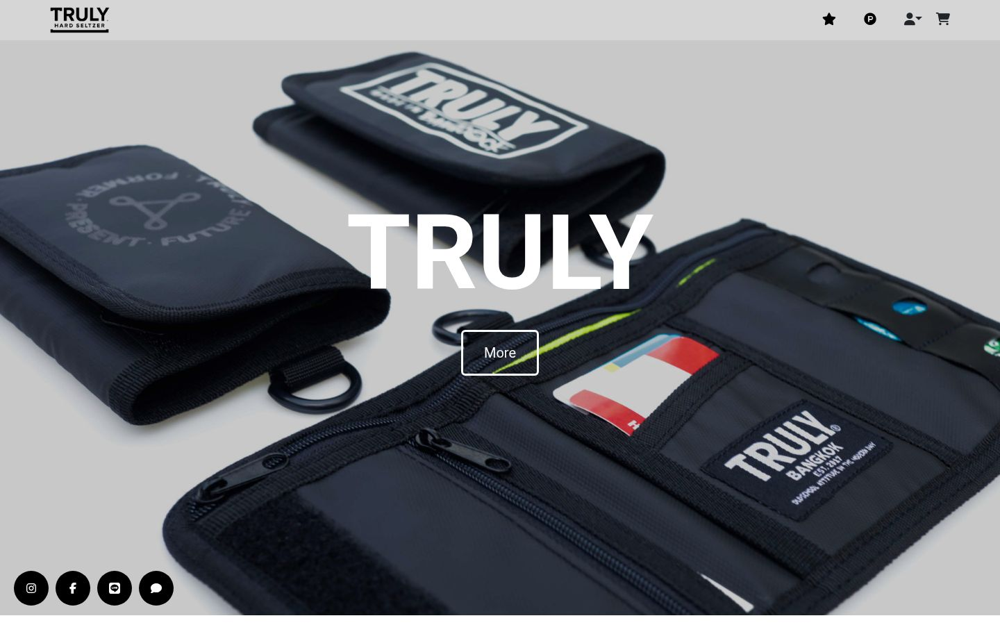
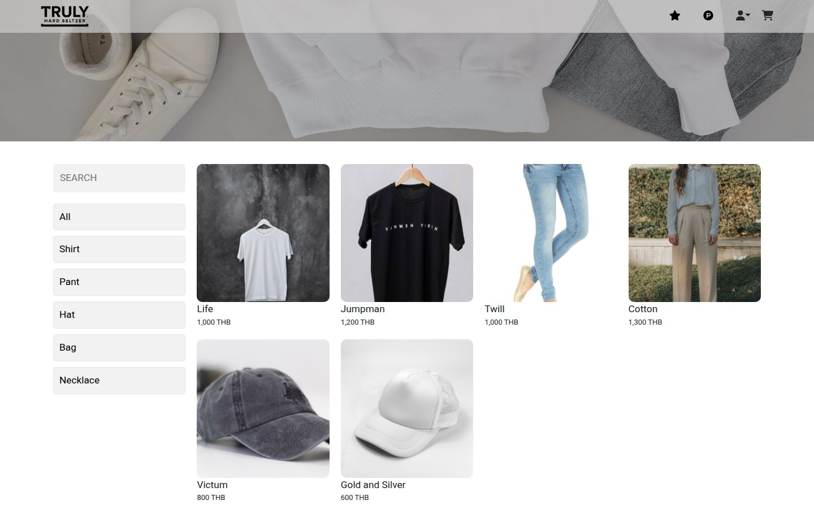
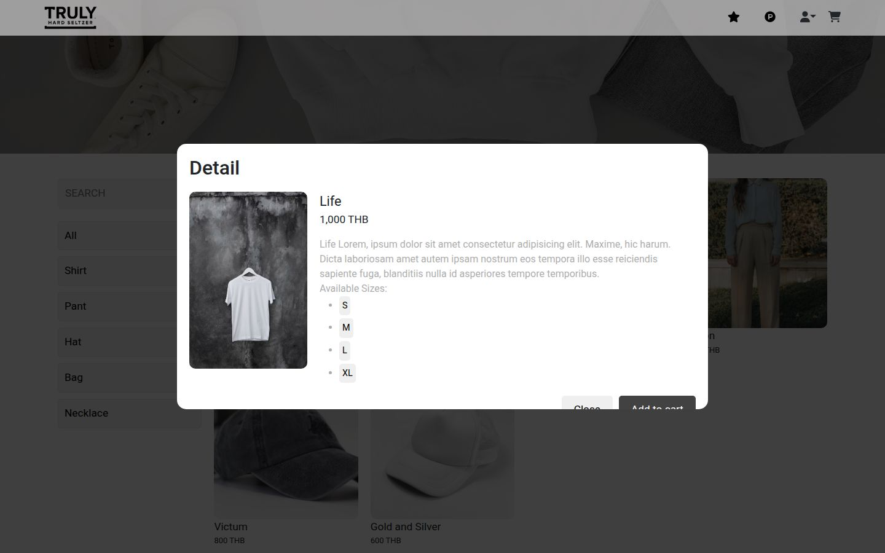
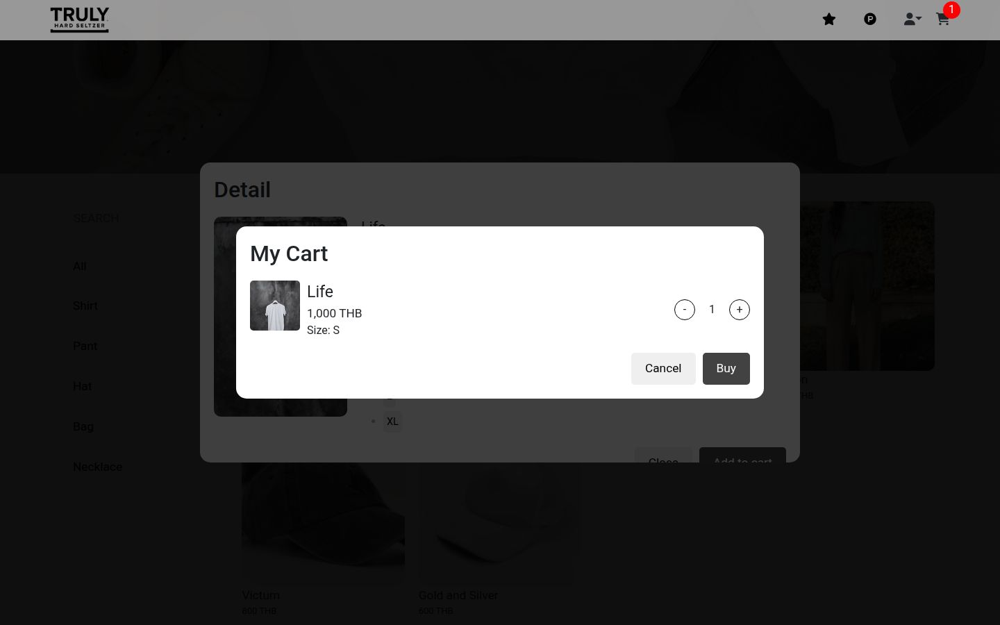
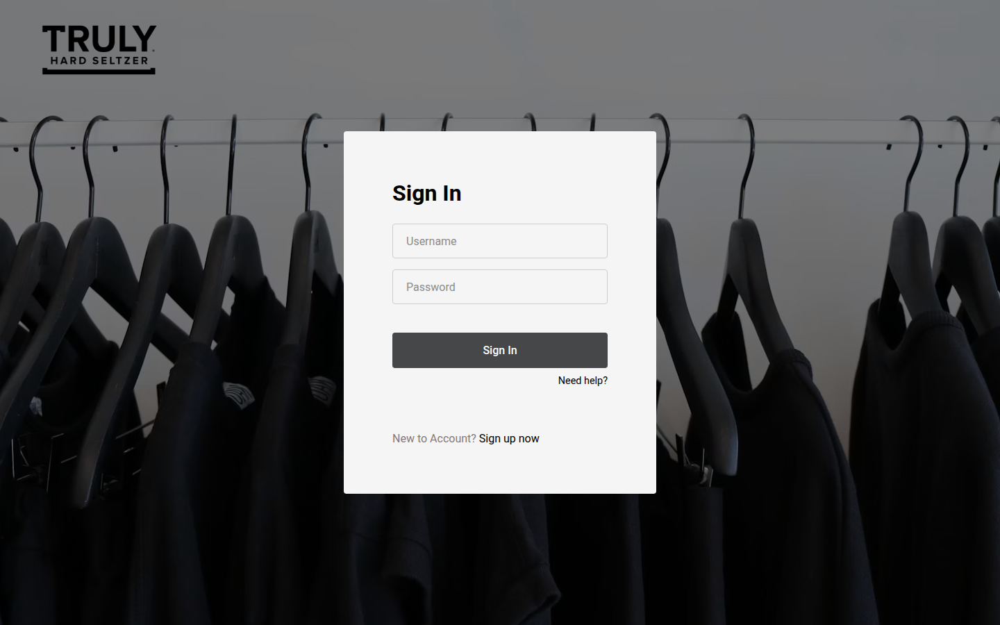
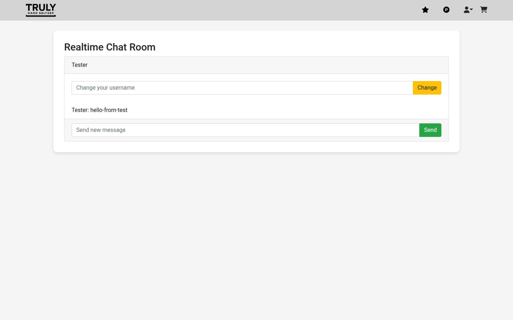

# Truly

Truly is an e-commerce web app made for the CS251 course at Thammasat University. It is built with Express, EJS, and Socket.IO.

The shop is a front end over a small Express server. The product catalog, cart, profile, orders, and reviews are static or kept in the browser. Chat messages live only in the Node process that is currently running. There is no database and no account system.

Live demo: [https://truly-clone.vercel.app](https://truly-clone.vercel.app)

## Features

- **Home** (`/`) — landing page with the Truly mark, campaign images, and links into the store. Sections fade in as they scroll into view. The footer has placeholder social icons and a link to the chat room.
- **Store** (`/Store`, also `/store`) — a Bootstrap carousel of the shirt images in `public/img/Proim/shirt`, plus a client-side catalog of six products (two shirts, two pants, two hats). You can search by name, filter by All, Shirt, Pant, Hat, Bag, or Necklace, open a detail modal, and add an item to the cart. Shirts and pants offer sizes S, M, L, and XL. Bag and Necklace are filters only; the catalog has no products of those types. The cart badge and cart modal can change quantity or remove a line, then link to checkout. An Edit control in the detail modal is present but hidden.
- **Checkout** (`/purchase`) — a static shipping address, one sample line item, a price table (item price, shipping, total), a credit-card form, a QR image, and a file input for a transfer slip. The card form stays in the browser and shows a confirmation alert. Nothing is charged and no order is saved. The quantity buttons update the line count, the summary count, and the total, and they keep the shipping amount shown on the page.
- **Purchase history** (`/history`) — one static sample order (price, size, tracking id, date, payment method, and logistics) and a review form with a comment box, an image input, and a star rating. The stars only toggle a CSS class. Submitting the form does not save a review.
- **Comments** (`/comment`) — static sample comments and a rating for one product.
- **Profile** (`/information`) and **edit profile** (`/information/edit`) — a static profile and address, and a form for changing them. The confirm control does not save anything.
- **Sign in** (`/login`) and **sign up** (`/Register`) — forms only. They are not sent to the server, and the app does not create a session.
- **Add product** (`/AddnewProduct`) — a form for name, price, description, size, type, and an image. On submit it shows a success alert and sends the browser to `/store`. The product is not stored. The nav link to this page is hidden.
- **Edit product** (`/Editproduct`) — a form titled for the product "Life" (name, price, description, image). The page script is empty, and there is no server route that saves the edit.
- **Chat** (`/chat`) — a Socket.IO room. A new connection is "Anonymous" until the visitor sets a username. Messages are broadcast to everyone connected to that server, and typing is broadcast to the other clients. Messages are not stored.

`POST /` logs the request body and redirects to `/`. None of the pages post to that route.

## Screenshots

Taken from a local run of this repo.













## Tech stack

- Node.js
- Express 4
- EJS
- Socket.IO 4 (server in `index.js`, browser client from the Socket.IO CDN)
- Bootstrap (files in `public/`, plus a Bootstrap 4 stylesheet from a CDN on the chat page)
- jQuery 3 and SweetAlert2 from CDNs, on the pages that use them
- Font Awesome and the Kanit font from CDNs

## Run locally

```bash
npm install
npm start
```

Then open [http://localhost:3000](http://localhost:3000).

`npm start` runs `node index.js`. There is no test suite; `npm test` is the placeholder that npm generates.

## Environment variables

| Name | Required | Purpose |
| --- | --- | --- |
| `PORT` | No | Port the HTTP server listens on. Defaults to `3000`. |

Copy `.env.example` to `.env` if you want to set `PORT` there. The app reads `process.env.PORT` only; it does not load a `.env` file by itself, so export the variable in the shell or set it in the process manager.

No API keys, database URLs, or passwords are read from the environment.

## Project structure

```
.
├── index.js                  Express routes and the Socket.IO server
├── package.json
├── package-lock.json
├── .env.example              PORT only
├── public/
│   ├── css/                  Page styles and Bootstrap
│   ├── img/                  Logos, home images, shirt carousel, QR
│   └── js/                   Catalog, cart, chat, checkout, home animation
├── views/
│   ├── *.ejs                 Pages
│   └── partials/             Nav, heads, and footers
└── docs/screenshots/         Images used in this README
```

| Route | Page |
| --- | --- |
| `GET /` | Home |
| `POST /` | Logs the body, redirects to `/` |
| `GET /Store` | Store |
| `GET /login` | Sign in |
| `GET /Register` | Sign up |
| `GET /history` | Purchase history |
| `GET /chat` | Chat room |
| `GET /AddnewProduct` | Add product |
| `GET /comment` | Comments |
| `GET /information` | Profile |
| `GET /information/edit` | Edit profile |
| `GET /purchase` | Checkout |
| `GET /Editproduct` | Edit product |

Express routing is not case sensitive, so `/store` and `/Store` are the same route.
